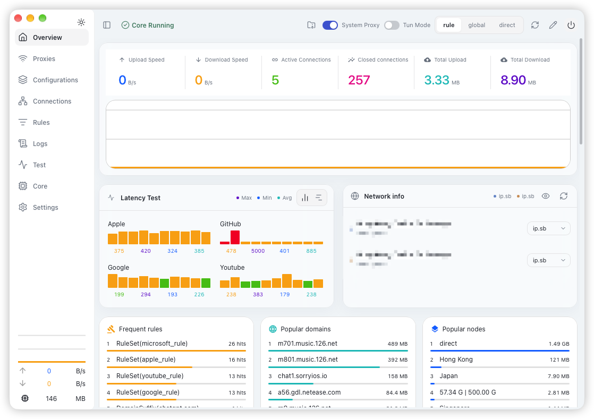
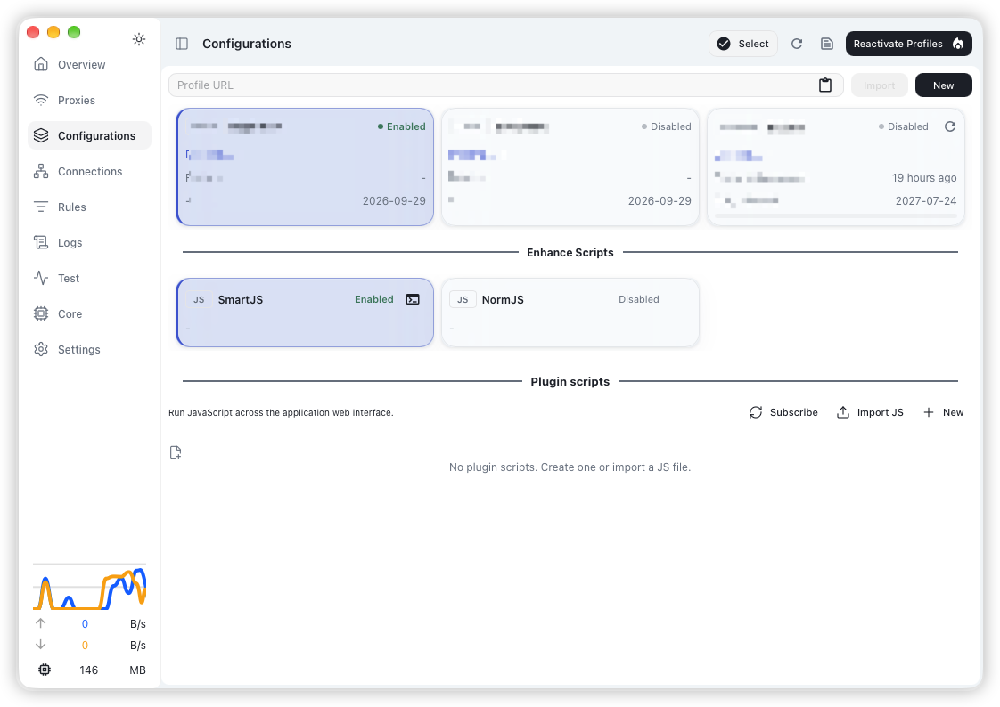

# ClashMorden

[简体中文](README.zh-CN.md) | [English](README.md)

<p align="center">
  
</p>

ClashMorden 是一款基于 Clash Verge Rev 的社区开发界面。它保留了大家熟悉的代理客户端操作流程，并加入了重新设计的概览面板、更丰富的连接分析以及焕然一新的视觉主题。

> **仅提供前端界面。** 发行包中不包含也不分发 Mihomo 或任何其他代理内核。用户必须自行准备兼容的内核。ClashMorden 不提供任何代理节点或网络服务。

**本项目将不再更新！！**

## 新特性

* **重新设计的概览面板：** 围绕你关注的信息自由排布仪表盘卡片，涵盖流量、延迟、连接动态、规则、域名以及代理节点。
* **连接拓扑：** 通过直观的可视化拓扑图查看当前活跃连接及其代理链路。
* **流量与目标分析：** 查看连接历史记录，并按目标地址、进程、规则及代理节点聚合统计流量。
* **网络地图：** 支持 2D 与 3D 视图自由切换，在平面地图或三维地球上直观查看目标服务器的地理位置。
* **焕新的主题系统：** 全面优化了间距、字体、配色及组件样式，内置 6 款预设主题，支持浅色/深色模式及自定义主题色调节。
* **井井有条的配置工具：** 在专属视图中轻松管理配置订阅、代理分组、分流规则、连接以及内核设置。
* **配置增强脚本：** 在配置激活或重新增强时，于配置处理链路中执行 JavaScript 增强脚本，实现配置文件的自动化调整。
* **应用插件脚本：** 支持创建或导入在应用 Web 界面全局运行的 JavaScript 脚本。脚本可注入自定义样式、响应页面路由跳转，并使用持久化存储；远程脚本还可直接通过源链接进行更新。

请仅安装来自可信来源的增强或插件脚本。脚本可能会读取/修改你的配置文件或与应用界面产生交互。在启用前，请务必仔细检查本地脚本与远程订阅源的内容。


## 界面预览

<p align="center">
  
</p>

<p align="center">
  
</p>

## 本地开发

桌面界面基于 Tauri。运行前请安装 Node.js、pnpm、Rust 和 Tauri 所需的平台依赖：

```shell
pnpm install
pnpm dev
```

仅构建前端资源：

```shell
pnpm web:build
```

> **仅提供前端界面。** 发布包不捆绑或分发 Mihomo 等代理内核，用户需要自行准备兼容的内核或在内核中配置下载。本项目不提供代理节点或网络服务。

## 致谢

ClashMorden 基于 [Clash Verge Rev](https://github.com/clash-verge-rev/clash-verge-rev) 和 [Clash Verge Self](https://github.com/oomeow/clash-verge-self) 开发。界面也参考了 [YACD](https://github.com/MetaCubeX/Yacd-meta)、[Zashboard](https://github.com/Zephyruso/zashboard) 以及其他代理软件的设计。项目使用了 [Mihomo](https://github.com/MetaCubeX/mihomo)、[Tauri](https://github.com/tauri-apps/tauri)、[React](https://github.com/facebook/react)、[Vite](https://github.com/vitejs/vite) 和 [Material UI](https://github.com/mui/material-ui) 等开源技术。详情请查看上游项目及[许可证](./LICENSE)。

## 许可证

[GPL-3.0](./LICENSE)。基于本项目进行再发布时，也需遵守所包含上游组件的许可证和声明要求。

> **仅提供前端界面。** 发布包不捆绑或分发 Mihomo 等代理内核，用户需要自行准备兼容的内核或在内核中配置下载。本项目不提供代理节点或网络服务。
